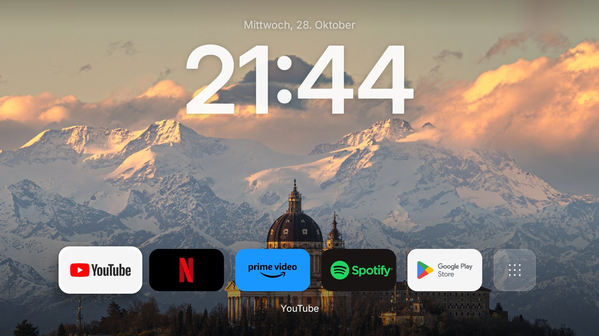
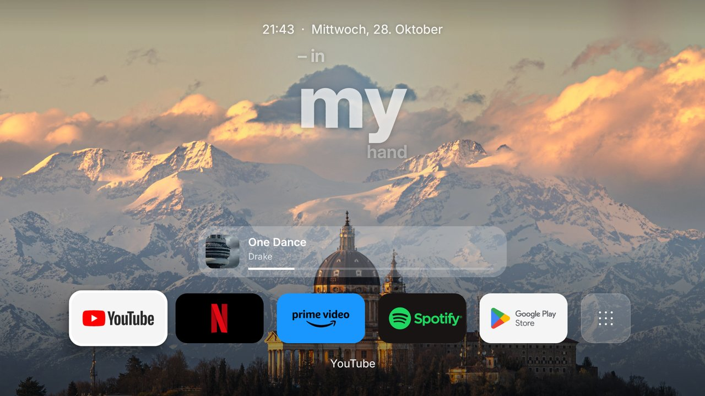
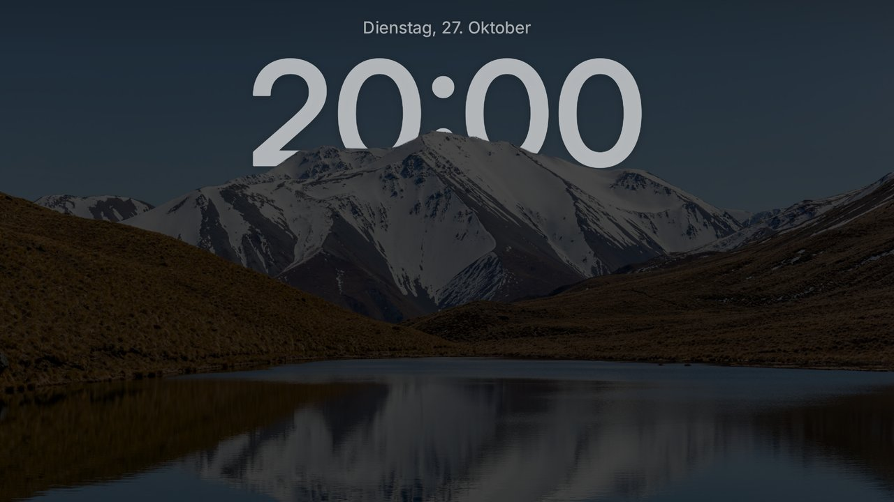

# Clean TV

Eine ruhige, werbefreie Startseite für **Android TV**: ein großes Foto, die Uhr hinter dem Berg wie beim iPhone, darunter nur deine Lieblings-Apps. Kostenlos und ohne Konto.

## Was Clean TV kann

- **Uhr hinter dem Motiv:** 35 Hintergründe in 4K (Berge, Seen, Städte …), bei denen die Uhr hinter dem Berg verschwindet.
- **Nur 5 Apps oben**, alles andere unter „Alle Apps“. Mit „OK lange drücken“ heftest du Apps oben an oder entfernst sie.
- **Musik auf der Startseite:** Läuft Spotify (oder eine andere Musik-App), erscheint der Liedtext Wort für Wort im Takt, dazu Cover, Fortschritt und Knöpfe (zurück, Pause, vor, Zufall, DJ).
- **Ruhemodus:** Nach 30 Sekunden ohne Taste (oder sofort mit Pfeil nach oben) verschwinden die Apps, nur Bild und Uhr bleiben, etwas dunkler.
- **Home-Leiste:** Home-Taste in einer App lässt unten eine kleine Leiste hochgleiten, zweimal Home führt zur Startseite.
- **Einschalt-Animation** mit dem Clean-TV-Logo.
- **Normales System:** Unter „Alle Apps“ → „Normales System“ wechselst du jederzeit zur originalen Google-Startseite zurück. Clean TV öffnen schaltet wieder um.

| Musik | Ruhemodus |
|---|---|
|  |  |

## Installieren (Windows-PC)

1. **Herunterladen:** Unter [Releases](../../releases/latest) die Dateien `CleanTV.apk`, `Einrichten.bat` und `Alte-Startseite-zurueck.bat` in einen Ordner laden.
2. **adb besorgen:** Die kostenlosen [SDK Platform-Tools von Google](https://developer.android.com/tools/releases/platform-tools) herunterladen und `adb.exe` (mit den beiden `.dll`-Dateien) in denselben Ordner legen.
3. **Am Fernseher:** Einstellungen → Geräteeinstellungen → Info → 7× auf „Build“ drücken. Dann unter „Entwickleroptionen“ **USB-Debugging** (und falls vorhanden **Netzwerk-Debugging / ADB über Netzwerk**) einschalten. Die IP-Adresse steht unter Einstellungen → Netzwerk.
4. **`Einrichten.bat` doppelklicken**, IP-Adresse eingeben. Am Fernseher „Debugging zulassen?“ mit „Immer zulassen“ bestätigen.

Fertig. Es wird nichts gelöscht: Die originale Startseite ist nur abgeschaltet. Mit `Alte-Startseite-zurueck.bat` oder in Clean TV über „Normales System“ kommt sie zurück.

> Für „Normales System“ fragt der Fernseher beim ersten Mal noch einmal „Debugging zulassen?“, weil Clean TV dafür das Netzwerk-Debugging der eigenen Box nutzt. Einfach „Immer zulassen“ wählen.

## Hinweise

- Getestet auf einer Android-TV-Box mit Android 14. Fernseher mit Google TV oder älterem Android TV sollten ebenfalls funktionieren.
- Liedtexte kommen von der freien Datenbank [LRCLIB](https://lrclib.net). Nicht jedes Lied hat dort zeitgenaue Texte; dann zeigt Clean TV den Songtitel.
- Clean TV sammelt keine Daten und braucht kein Konto.

## Selbst bauen

Android Studio bzw. Gradle 8.10, JDK 17: `gradle assembleRelease`. Die Werkzeuge im Ordner `tools/` (Python) erzeugen die Hintergründe mit Freistellung (Himmel-Erkennung mit SegFormer).

## Lizenz

Programmcode: MIT (siehe `LICENSE`). Fotos und Schrift: siehe [CREDITS.md](CREDITS.md). Clean TV ist ein privates Projekt und steht in keiner Verbindung zu Google, Spotify, Netflix oder anderen genannten Firmen; deren Namen und Logos gehören den jeweiligen Inhabern.
